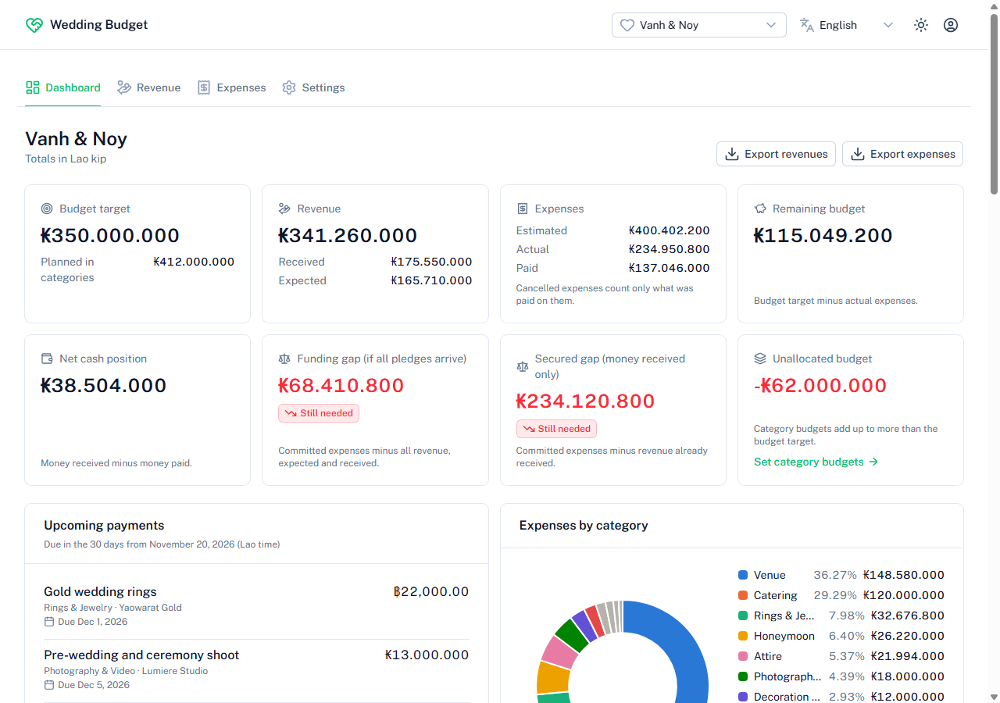

# Wedding Budget Planner

Plan a wedding budget in **Lao kip, US dollars and Thai baht**. Record what comes in (family
contributions, gifts, savings) and what goes out (venue, catering, attire…), pay expenses in
instalments with receipts, and follow everything on a dashboard in one base currency.



- **Revenue**: expected and received money per source, in LAK, USD or THB.
- **Expenses**: estimate, actual (invoiced) amount, payments with receipts (image or PDF);
  the status (partially paid, paid, overpaid) follows from the payments.
- **Exchange rates**: entered by hand in Settings. Every record keeps the rate of its own
  date, so later rate changes never rewrite history.
- **Dashboard**: budget target, remaining budget, net cash, funding gaps, budget vs actual per
  category, monthly cash flow, upcoming payments (Lao time), unplanned spending.
- **CSV export** of revenue and expenses (Excel opens Lao text correctly).
- English and Lao interface (the Lao translation is a draft awaiting review).

The money and currency rules are in [backend/docs/business-rules.md](backend/docs/business-rules.md).

## Repository

```
backend/    Laravel 13 API (PHP 8.5, MySQL, Sanctum SPA cookie auth)
frontend/   Nuxt 4 SPA (Nuxt UI, Pinia, Chart.js), talks to the API over HTTP only
docker/     nginx and PHP configuration for the Docker images
docker-compose.yml, .env.docker.example   production-like stack on one origin
```

## Local development on Windows with Herd

This is the setup the project was built with.

**Prerequisites**

- [Laravel Herd](https://herd.laravel.com) with **PHP 8.5** (bcmath is included).
- MySQL 8.4 or newer on `127.0.0.1:3306` (Herd Pro's MySQL service, or a standalone install).
- Node.js 24 LTS with Corepack (`corepack enable`; pnpm comes from `packageManager`).

> If `php -v` reports 8.4 (e.g. a *herd-lite* install earlier on `PATH`), call Herd's PHP 8.5
> explicitly: `%USERPROFILE%\.config\herd\bin\php85\php.exe`. Composer's platform check
> refuses PHP 8.4.

**Backend** (http://localhost:8000)

```powershell
cd backend
copy .env.example .env          # set DB_DATABASE / DB_USERNAME / DB_PASSWORD
composer install
php artisan key:generate
php artisan migrate --seed      # --seed adds the demo wedding (not in production)
php artisan serve --host=localhost --port=8000
```

**Frontend** (http://localhost:3000)

```powershell
cd frontend
copy .env.example .env          # NUXT_PUBLIC_API_BASE=http://localhost:8000
pnpm install
pnpm dev
```

Log in with the demo account **demo@example.com / password**, or register a new one.

The two apps run on different ports, so the backend `.env` must allow the frontend:
`FRONTEND_URL=http://localhost:3000` (CORS), `SANCTUM_STATEFUL_DOMAINS=localhost:3000` and
`SESSION_DOMAIN=localhost`. Both use `localhost`, never `127.0.0.1`, or the browser treats them
as different sites and drops the session cookie.

## Running with Docker

The Docker stack serves the whole app on **one origin**: nginx serves the built frontend
(static files) at `/` and passes `/api`, `/sanctum` and `/up` to Laravel. The session cookie
is first-party, with no CORS or cookie-domain setup.

| Service | Image | Notes |
|---|---|---|
| `web` | nginx (unprivileged) + static Nuxt build | the only published port (`APP_PORT`, default 8080); security headers |
| `app` | PHP 8.5-FPM, Laravel, `composer install --no-dev`, OPcache | runs as `www-data`; config/routes/views cached at start |
| `mysql` | MySQL 8.4 | named volume `mysql-data`, not published |

Receipts are on the named volume `receipts`, mounted only in `app`: nginx cannot serve them.
Images contain no `.env` and no secrets; settings come from the environment.

**1. Configure** (once)

```bash
cp .env.docker.example .env
```

Fill in `DB_PASSWORD` and `MYSQL_ROOT_PASSWORD` (long random values) and `APP_KEY`:

```bash
docker run --rm php:8.5-cli-alpine php -r "echo 'base64:'.base64_encode(random_bytes(32)).PHP_EOL;"
```

For a local trial on `http://localhost:8080`, keep `SESSION_SECURE_COOKIE=false`; in
production it must be `true` (see the checklist below).

**2. Build, migrate, start**

```bash
docker compose build
docker compose run --rm app php artisan migrate --force   # one-off; never on container start
docker compose up -d --wait
```

Open http://localhost:8080 and register. The production image has no demo seeder (Faker is a
development dependency); use the Herd setup for demo data.

**Releases**: `git pull`, then `docker compose build`, run the migration command again, and
`docker compose up -d --wait`. Logs: `docker compose logs -f app web`.

The `Docker` GitHub workflow runs exactly these steps on every push and then
[.github/scripts/docker-smoke.sh](.github/scripts/docker-smoke.sh) against the stack
(security headers, register, wedding, payment, receipt upload and signed download, dashboard).

## Running tests

**Backend** (`backend/`, Pest)

```bash
vendor/bin/pest --parallel        # whole suite (uses .env.testing; see .env.testing.example)
vendor/bin/pest --filter=Dashboard
vendor/bin/pint --test            # code style
```

Coverage and mutation testing need a coverage driver. Herd ships Xdebug: put an ini file with
`zend_extension="C:\Program Files\Herd\resources\app.asar.unpacked\resources\bin\xdebug\xdebug-8.5.dll"`
and `xdebug.mode=coverage` in a folder, point `PHP_INI_SCAN_DIR` at that folder, then:

```bash
vendor/bin/pest --coverage --parallel
vendor/bin/pest --mutate --path=app/Services/CurrencyConversionService.php,app/Services/DashboardSummaryService.php
```

On Windows, pass `--mutate` paths with one comma-separated `--path` (`--class` finds nothing,
and repeated `--path` options keep only the last).

**Frontend** (`frontend/`, Vitest)

```bash
pnpm test        # unit tests (money formatting, MoneyInput, API client, dashboard helpers, i18n)
pnpm coverage    # same, with a coverage report in coverage/
pnpm lint
pnpm typecheck
```

## Production deployment checklist

Two supported layouts:

- **Docker, one origin** (recommended): the stack above behind a TLS-terminating reverse proxy
  or load balancer. The proxy must set `X-Forwarded-Proto: https`; nginx then tells Laravel the
  request is HTTPS and sends HSTS.
- **Separate frontend and API hosts** on the same parent domain (e.g. `app.example.com` and
  `api.example.com`): see [backend/docs/production-deployment.md](backend/docs/production-deployment.md)
  for the `SESSION_DOMAIN`, CORS and Sanctum settings this needs.

Checklist:

- [ ] **HTTPS only**, HTTP redirected to HTTPS at the proxy; HSTS on (nginx sends it for HTTPS requests).
- [ ] `APP_ENV=production`, **`APP_DEBUG=false`**.
- [ ] **`SESSION_SECURE_COOKIE=true`** (cookies only over HTTPS; HttpOnly and SameSite=lax are defaults).
- [ ] `APP_URL` = the public `https://` URL (signed receipt links are absolute);
      `SANCTUM_STATEFUL_DOMAINS` = its host.
- [ ] `APP_KEY` generated once, stored in your secret manager, never changed (it signs receipt
      links and encrypts sessions).
- [ ] Strong `DB_PASSWORD` / `MYSQL_ROOT_PASSWORD`; MySQL not published to the internet.
- [ ] Migrations run as the one-off command on each release, before `up`.
- [ ] Backups of **both** the MySQL volume **and** the receipts volume, on a schedule, copied off
      the server, and a restore tested (below).
- [ ] Receipt URLs kept out of access logs (the nginx config logs paths without query strings
      and does not log `/api/v1/receipts/` at all).

### Backups

The database and the receipts belong together: payments reference receipt files by path. Back
up both at the same time.

```bash
mkdir -p backups
# Database (consistent snapshot of InnoDB tables, no locks)
docker compose exec -T mysql sh -c 'exec mysqldump --single-transaction --routines --no-tablespaces -u"$MYSQL_USER" -p"$MYSQL_PASSWORD" "$MYSQL_DATABASE"' \
  | gzip > backups/db-$(date +%F).sql.gz
# Receipts volume
docker run --rm -v wedding-budget_receipts:/data:ro -v "$PWD/backups":/backup alpine \
  tar czf /backup/receipts-$(date +%F).tar.gz -C /data .
```

`backups/` is git-ignored. Copy the files to storage outside the server.

### Restore

```bash
docker compose stop web app
# Database
gunzip < backups/db-2026-11-20.sql.gz | docker compose exec -T mysql sh -c 'exec mysql -u"$MYSQL_USER" -p"$MYSQL_PASSWORD" "$MYSQL_DATABASE"'
# Receipts (replaces the volume's content)
docker run --rm -v wedding-budget_receipts:/data -v "$PWD/backups":/backup alpine \
  sh -c 'rm -rf /data/* && tar xzf /backup/receipts-2026-11-20.tar.gz -C /data && chown -R 82:82 /data'
docker compose up -d --wait
```

`82` is `www-data` in the Alpine PHP image. Restore onto the same `APP_KEY`: sessions and any
signed links issued before the backup depend on it.

## Documentation

- [backend/docs/business-rules.md](backend/docs/business-rules.md): currency, rate snapshots,
  rounding, expense status and payments, dashboard figures, CSV export, deletion rules.
- [backend/docs/production-deployment.md](backend/docs/production-deployment.md): split-host
  deployment (frontend and API on different subdomains).
- [backend/database/ERD.md](backend/database/ERD.md): database schema.
