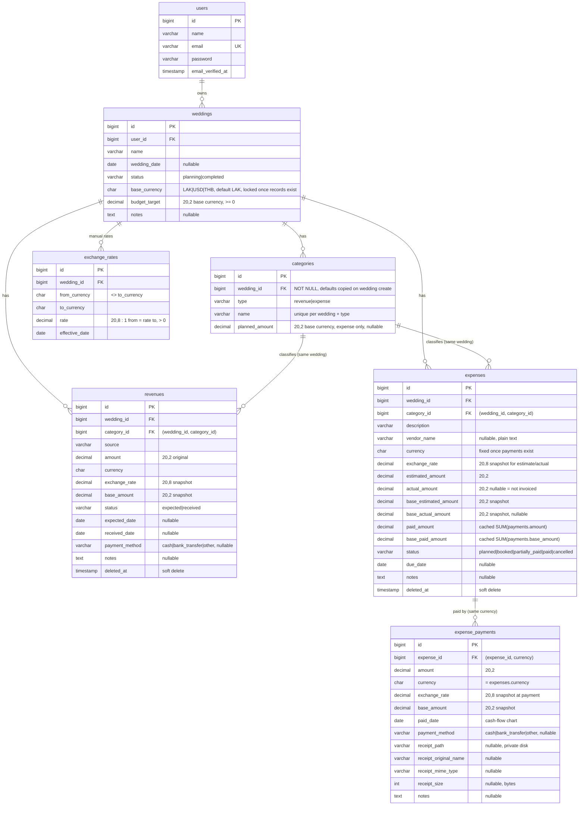

# Entity Relationship Diagram

Domain tables for the Wedding Budget Planner MVP. Laravel framework tables
(`password_reset_tokens`, `sessions`, `cache`, `jobs`, `personal_access_tokens`) are omitted.



## Key rules encoded in the schema

| Rule | How |
|---|---|
| Exact money | `DECIMAL(20,2)` amounts, `DECIMAL(20,8)` rates. No `FLOAT`. |
| Valid values | MySQL `CHECK`: amounts `>= 0` (estimates may be 0), payment `amount > 0`, rates `> 0`, `from_currency <> to_currency`, `planned_amount` only on expense categories. |
| Historical immutability | Records and payments store `exchange_rate` + `base_*` snapshots; no FK to `exchange_rates`. |
| Consistent base totals | `weddings.base_currency` locked once revenue/expenses exist (enforced in Form Request). |
| Ownership / IDOR | Every domain row reaches `users` through `weddings.user_id`. Composite FK `(wedding_id, category_id) -> categories(wedding_id, id)` stops a record using another wedding's category. |
| Payment currency | Composite FK `(expense_id, currency) -> expenses(id, currency)`: payments share the expense currency, and the expense currency cannot change once payments exist (`ON UPDATE RESTRICT`). |
| Paid totals | `expenses.paid_amount` / `base_paid_amount` are cached sums, rewritten in the same transaction as any payment change. `partially_paid` / `paid` derive from `paid_amount` vs `actual_amount`. |
| Query speed | Composite indexes lead with `wedding_id`: `(wedding_id, status)`, `(wedding_id, currency)`, `(wedding_id, received_date)`, `(wedding_id, due_date)`; payments use `(expense_id, paid_date)`. |
| Rate lookup | Unique `(wedding_id, from_currency, to_currency, effective_date)` also serves "latest rate on or before date". |

## Delete rules

| Foreign key | On delete | Why |
|---|---|---|
| `categories.wedding_id`, `exchange_rates.wedding_id`, `revenues.wedding_id`, `expenses.wedding_id` | CASCADE | Owned by the wedding. |
| `expense_payments.(expense_id, currency)` | CASCADE | A payment has no meaning without its expense (only reached on force delete). |
| `revenues.(wedding_id, category_id)`, `expenses.(wedding_id, category_id)` | RESTRICT | Deleting a category must never delete financial records. |
| `weddings.user_id` | RESTRICT | Account removal must go through the wedding delete action, never a silent cascade. |

**Category delete** (`App\Actions\Categories\DeleteCategory`) attempts the `DELETE` and maps MySQL
error 1451 to `CategoryInUseException`, rendered as `409 {"code": "category_in_use"}`. Soft-deleted
records count as in use. Letting the FK decide is atomic; a "count, then delete" check would race.

**Wedding delete** (`App\Actions\Weddings\DeleteWedding`). Because of the RESTRICT category FKs, a plain
`DELETE FROM weddings` fails once records exist:

```
SQLSTATE[23000]: 1451 Cannot delete or update a parent row: a foreign key constraint fails
(`expenses`, CONSTRAINT `expenses_category_id_foreign` ... ON DELETE RESTRICT)
```

InnoDB reached `categories` (via `categories_wedding_id_foreign`) before `expenses`, and `RESTRICT` is
checked per row immediately, not at commit. The action therefore locks the wedding row and deletes in
one transaction, children first: payments, then expenses and revenues (query builder, so soft-deleted
rows are purged too), then categories, exchange rates and the wedding. Receipt files on the private
`receipts` disk are removed only after the commit.

Covered by `tests/Feature/Database/SchemaIntegrityTest.php` and `tests/Feature/Actions/`.
