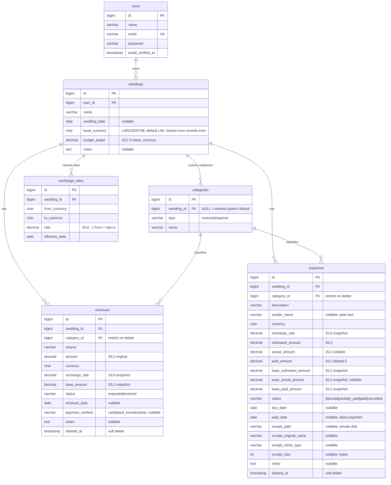

# Entity Relationship Diagram

Domain tables for the Wedding Budget Planner MVP. Laravel framework tables
(`password_reset_tokens`, `sessions`, `cache`, `jobs`, `personal_access_tokens`) are omitted.

## Key rules encoded in the schema

| Rule | How |
|---|---|
| Exact money | `DECIMAL(20,2)` amounts, `DECIMAL(20,8)` rates. No `FLOAT`. |
| Historical immutability | Records store `exchange_rate` + `base_*` snapshots; no FK to `exchange_rates`. |
| Consistent base totals | `weddings.base_currency` locked once revenue/expenses exist (enforced in Form Request). |
| Ownership / IDOR | Every domain row reaches `users` through `weddings.user_id`. |
| Category safety | `category_id` is `RESTRICT ON DELETE`; deleting a wedding cascades to its custom categories, rates and records. |
| Query speed | Composite indexes lead with `wedding_id`: `(wedding_id, status)`, `(wedding_id, currency)`, `(wedding_id, received_date)`, `(wedding_id, due_date)`, `(wedding_id, paid_date)`. |
| Rate lookup | Unique `(wedding_id, from_currency, to_currency, effective_date)` also serves "latest rate on or before date". |
